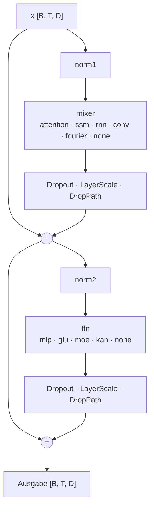
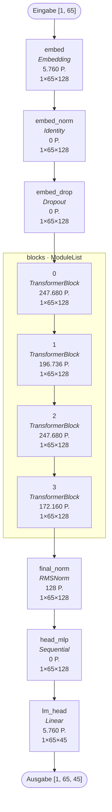

# KI-Baukasten – Architektur und Eingriffspunkte

Dieses Dokument erklärt, **wie eine KI im Baukasten aufgebaut ist**, wie die Teile zusammenspielen und **wo man
eingreifen kann** – von der ganzen Architektur bis zum einzelnen Gewicht. Am Ende steht eine automatisch erzeugte,
vollständige Aufbau-Darstellung eines Beispielmodells (so sieht die Ausgabe von `Project.architecture()` aus).

---

## 1. Vom Text zur trainierten KI

```mermaid
flowchart LR
  Z["Ziele<br/>goals · from_goals"] -->|empfiehlt Vorlage + Techniken| A
  T["Techniken-Katalog<br/>enable / disable"] -->|setzt Einstellungen| A
  P["Anforderungs-Katalog<br/>perfection_check · apply_perfection"] -->|prüft + schaltet Techniken| T
  DQ["Daten<br/>CSV · Texte · Bilder · Masken · WAV · Anweisungen<br/>data_check · Aufteilung · Testmenge"] --> B
  A["ProjectConfig<br/>(JSON/YAML/Python)"] --> B["Validierung<br/>+ auto_fit_dims"]
  B --> C["Registry 'model'<br/>baut das Modell"]
  C --> D["Modul-Chirurgie<br/>module_rules"]
  D --> E["Tensor-Chirurgie<br/>tensor_rules"]
  E --> F["MemoryManager<br/>Präzision · Quantisierung · LoRA ·<br/>Checkpointing · Streaming/Offload"]
  F --> G["Trainer<br/>Paradigma · Optimierer · Zeitplan ·<br/>Verluste · Callbacks · Logger · Cluster"]
  W["Ablauf (workflow)<br/>Suche · föderiert · Model Soup"] -->|run| G
  G --> M["Bewertung<br/>Metriken · test · baseline · error_analysis"]
  M --> V["Vertrauen<br/>calibrate · Conformal · MC-Dropout · TTA ·<br/>explain · fairness · robustness"]
  V --> R["Zielsystem-Übersicht<br/>recommend_for · reduce_for"]
  R --> K["Kompression<br/>Pruning · Low-Rank · Quantisierung ·<br/>Heilen / Lehrer-Schüler"]
  K --> EX["Export-Vorbereitung (Kopie)<br/>Hüllen weg · EMA · LoRA · BatchNorm falten ·<br/>Ungenutztes entfernen · geprüft"]
  EX --> H["Projekt speichern<br/>projekt.json (kompakt) · modell.pt · vorverarbeitung.json ·<br/>MODELLKARTE.md · umgebung.json"]
  H --> I["Inferenz / Generierung (Cache, Beam Search)<br/>predict_raw · HTTP-Dienst · Export (torch.export, ONNX …)"]
  I --> DR["Betrieb<br/>drift_report · continue_training"]
  X["Fremdes Modell<br/>.pt2 · TorchScript · state_dict · HF"] -->|import_model| D
```



| Schritt | Code | Eingriff über |
|---|---|---|
| Konfiguration | `core/config.py` (`Param`, `BaseConfig`) | `Project.set/set_all/update`, Datei, GUI |
| Komponenten | `core/registry.py`, `core/component.py` | Komponentenname + Argumente, eigene Registrierung |
| Modellbau | `models/*` | `model.*`, `model.block.*`, `model.layer_overrides` |
| Modul-Chirurgie | `tensor/modules.py` | `module_rules` |
| Tensor-Chirurgie | `tensor/surgery.py` | `tensor_rules` |
| Speicher | `memory/*` | `memory.*` |
| Training | `training/*` | `training.*` |
| Analyse | `analysis/*` | `architecture()`, `advise()`, `export()`, Probelauf (`analysis/probe.py`) |
| Kompression | `compress/*` | `compress()`, `compression.steps`, `distill()` |
| Zielsysteme | `analysis/targets.py` | `deployment.*`, `recommend_for()`, `reduce_for()` |
| Import | `models/external.py` | `Project.import_model()`, Modell `extern` |
| Ziele | `analysis/goals.py` | `goals.*`, `Project.from_goals()`, `set_goals()`, `goal_check()` |
| Techniken | `techniques.py` | `Project.enable()/disable()/techniques()` |
| Schalter | `core/switches.py` | `Project.switch()`, `set(pfad, "aus")`, `switches()` |
| Notfall-Ausführung | `analysis/fallback.py`, `memory/streaming.py`, `memory/offload.py`, `memory/execution.py` | `fallback_options()`, `apply_fallback()`, `memory.offload.*`, `memory.oom_strategy` |
| Cluster | `training/distributed.py` | `training.distributed.*`, CLI `verteilt` |
| Logger | `training/logger.py` | `training.logging.*`, `Project.add_logger()` |
| Ablauf | `workflow/*` | `workflow.*`, `Project.run()`, `tune()`, `federated_train()`, `model_soup()` |
| Anforderungen | `requirements.py` | `Project.perfection_check()`, `apply_perfection()`, CLI `perfektion` |
| Daten | `data/files.py`, `data/tokenizers.py`, `data/domains.py`, `training/data_utils.py` | `data.*`, `training.validation_strategy`, `training.test_split` |
| Datenprüfung & Drift | `analysis/datacheck.py`, `analysis/drift.py` | `data_check()`, `apply_data_fixes()`, `drift_report()`, `workflow.check_data` |
| Metriken | `training/metrics.py` | `training.metrics`, `training.auto_metrics`, `evaluate()`, `test()`, `baseline()`, `error_analysis()` |
| Vertrauen | `analysis/inference.py`, `analysis/explain.py`, `analysis/fairness.py`, `analysis/robustness.py` | `inference.*`, `calibrate()`, `predict_with_uncertainty()`, `explain_prediction()`, `feature_importance()`, `fairness_report()`, `training.adversarial`, `robustness_report()` |
| Wenige Labels | `workflow/active.py` | `select_for_labeling()`, `pseudo_label()` |
| Hardware-Automatik | `memory/hardware.py`, `training/optimizers.py` (`_fast`) | `memory.mixed_precision/matmul_precision = 'auto'`, `cudnn_benchmark`/`channels_last`/`training.pin_memory` = None, `hardware_report()` |
| Schlanker Export | `analysis/export.py` | `deployment.export.*`, `export(...)`, `last_export` |
| Ein-Aufruf-Einstieg | `project.py` (`Project.auto`, `detect_data`) | CLI `auto`, GUI „Datei → Automatisch aus Daten…“ |
| Einsatz | `analysis/modelcard.py`, `data/artifacts.py`, `ui/serve.py` | `model_card()`, `save()/load()`, `predict_raw()`, `serve()`, `deployment.server.*`, `generation.*` |

---

## 2. Ebenen der Anpassung

Ganz oben stehen drei Bedien-Ebenen: **Ziele** (der Assistent wählt Vorlage und Techniken), **Techniken** (benannte
Bündel von Einstellungen mit Status an/aus/teilweise) und **Schalter** je Einstellung (an = empfohlener Wert, aus =
wirkungslos, eigen = eigener Wert). Darunter liegen die Werkzeuge für feinste Eingriffe.

Von grob nach fein – jede Ebene kann **für alle**, **nur bestimmte** oder **genau ein** Element gelten:

| Ebene | Werkzeug | Für alle | Nur bestimmte | Genau eines |
|---|---|---|---|---|
| Einstellung | `set_all(muster, wert, scope, pick)` | `"dropout"` | `scope="nur_auswahl", pick="0,2"` | `scope="nur_einer"` |
| Schicht (vor dem Bau) | `model.block` + `model.layer_overrides` | `model.block.*` | Selektor `"::2"`, `"2-5"` | Selektor `"-1"` |
| Übernahme zwischen Schichten | `@von`, `@nur`, `@ausser` | `{"@von": 0}` | `{"@von": 0, "@nur": [...]}` | `{"@von": 0, "@nur": "mixer.num_heads"}` |
| Gebautes Modul | `module_rules` | `module_type="Dropout"` | `layers="0:4"`, `scope="nur_auswahl"` | `match="exact"` / `scope="nur_einer"` |
| Tensor / Ausschnitt | `tensor_rules` | `target=".*"` | `layers`, `pick`, `alle_ausser` | `match="exact"` + `index="0:8, :"` |

Faustregel: **Was die Architektur bestimmt** (Kopfzahl, Mixer, FFN-Art) gehört in `layer_overrides`, **was am gebauten
Netz passiert** (ersetzen, einfrieren, LoRA, Hooks, Präzision einzelner Module) in `module_rules`, **was einzelne
Gewichte betrifft** (Initialisierung, Pruning, Lernraten, Beschränkungen, Werte kopieren) in `tensor_rules`.

---

## 3. Aufbau eines Transformer-Blocks



* `norm_position`: pre (Bild oben), post, sandwich, none; `parallel`: Mixer und FFN gleichzeitig (GPT-J).
* Encoder-Decoder: zusätzlicher Cross-Attention-Zweig zwischen Mixer und FFN.
* Pfade der Module (für Regeln): `blocks.<i>.norm1`, `blocks.<i>.mixer` (bei Attention: `blocks.<i>.mixer.attn.q_proj` …),
  `blocks.<i>.ffn` (`.gate`, `.up`, `.down` bei GLU), `blocks.<i>.norm2`.

### Mixer im Detail

| Mixer | Kern | Cache bei Generierung | Speicher/Tempo-Schalter |
|---|---|---|---|
| attention | Q/K/V-Projektionen → (QK-Norm) → RoPE → Kernel → O-Projektion | Keys/Values (bzw. MLA-Latent) | `num_kv_heads`, `kv_compression_dim`, `window_size`, Kernel-`backend` |
| ssm | in_proj → kausale Faltung → (Δ, B, C) → selektiver Scan → Gate → out_proj | Faltungsfenster + Zustand h | `scan_mode`, `scan_backward`, `scan_chunk_size`, `d_state` |
| rnn | GRU/LSTM/RNN/minGRU | versteckter Zustand | `cell = mingru` (paralleler Scan) |
| conv | Tiefenfaltung über die Zeit | letzte k−1 Eingaben | `kernel_size` |

---

## 4. Speicher: wo er hingeht und welche Weiche hilft

| Posten | Größe (Training) | Weichen |
|---|---|---|
| Gewichte | N · Bytes | `param_dtype`, `quantization` (int8/int4/nf4), `offload.mode = stream` |
| Gradienten | N_trainierbar · Bytes | Einfrieren, `lora`, `offload.mode = stream` |
| Optimierer | 0–2 · N_trainierbar · 4 B | `adamw8bit`, `lion`, `adafactor`, `lora`, `stream` (liegt im RAM) |
| Aktivierungen | ∝ Batch · Länge · Breite · Tiefe | `mixed_precision`, `gradient_checkpointing`, `activation_offload`, `scan_backward = fused` (SSM), Akkumulation |
| KV-Cache (Generierung) | 2 · B · T · H_kv · hd pro Schicht | `num_kv_heads`, `kv_compression_dim`, `cache.dtype`, `cache.max_length` |

Ablauf in `MemoryManager.prepare_model`: Datentyp → Quantisierung → LoRA → Fake-Quantisierung → Checkpointing →
Platzierung (Streaming / Swapping / Gerät) → `channels_last` → `torch.compile`.

### Trainierbares Streaming (RAM)

```mermaid
sequenceDiagram
  participant RAM as CPU-RAM (Gewichte, Gradienten, Adam-Zustände)
  participant GPU as Rechengerät
  RAM->>GPU: Kopie Block i (Forward, ohne Autograd)
  GPU-->>GPU: Ausgabe; nur Block-Eingabe gemerkt
  Note over GPU: … alle Blöcke …
  RAM->>GPU: Kopie Block i (Backward)
  GPU-->>GPU: Neuberechnung (gleicher RNG/autocast) + Gradienten
  GPU->>RAM: Gewichts-Gradienten (summiert in param.grad)
  RAM-->>RAM: Optimierer-Schritt auf der CPU
```

---

## 5. Modelle verkleinern – was dabei passiert

| Verfahren | Wirkt auf | Wie die Form gespeichert wird |
|---|---|---|
| `prune_heads` | `q_proj`/`o_proj` (+ `k/v_proj` bei Gruppen) jeder Attention | Modul-Regel `resize_attention` |
| `prune_ffn` | `up`/`gate`/`down` jedes MLP-/GLU-FFN (auch MoE-Experten) | Modul-Regeln `resize_linear` |
| `drop_layers` | Einträge der Block-Liste | Modul-Regel `drop_items` |
| `prune_mlp` | versteckte Schichten des Modells `mlp` (+ Normen, Projektionen) | `resize_linear`, `resize_norm` |
| `low_rank` | `nn.Linear` → zwei schmale Schichten | Modul-Regel `factorize` |
| `quantize` | `nn.Linear` → `QuantLinear` | Modul-Regel `quantize` |

Beim Laden baut der Baukasten das Original, wendet diese Regeln an (gleiche Formen) und lädt dann die gespeicherten
Gewichte – so bleibt jede Kombination aus Umbau, Kompression und Training reproduzierbar.

## 5b. Bewertung und Vertrauen – wie die Teile zusammenspielen

1. **Sammeln statt mitteln**: Paradigmen melden in der Evaluierung ihre Vorhersagen über `trainer.collect(pred, ziel,
   art)`; ein `Collector` sammelt sie kompakt (Sprachmodelle nur Token-IDs + Verlust je Token, Segmentierung nur die
   Klassenkarte) und berechnet danach alle Metriken über **alle** Beispiele. Skalierte Regressionsziele werden vorher
   zurückgerechnet (`trainer.target_inverse`) – Fehler erscheinen in echten Einheiten.
2. **Aufteilen ohne Leck**: `split_indices` (zufall/stratifiziert/zeitlich) teilt Validierung und Testmenge ab; die
   CSV-Vorverarbeitung und Tokenizer lernen nur auf Trainingszeilen. Die Testmenge bleibt beim Neutrainieren dieselbe.
3. **Nach dem Training**: `calibrate()` stellt `inference.temperature`, `threshold` und `conformal_q` auf der
   Validierung ein; `predict_proba/predict_with_uncertainty` wenden sie an (plus MC-Dropout/TTA). Einstellungen unter
   `inference`, `generation`, `deployment`, `goals`, `workflow` verwerfen ein trainiertes Modell nicht.
4. **Speichern für den Einsatz**: `data/artifacts.py` schreibt Tokenizer, Tabellen-Vorverarbeitung, Klassen und
   Normierung als JSON; `predict_raw` und der HTTP-Dienst verarbeiten Rohdaten damit genau wie im Training.
5. **Perfektions-Check**: `requirements.py` ordnet jeder Anforderung Techniken (Status aus dem Katalog), eigene
   Prüfungen (z. B. „wurde `test()` ausgeführt?“) oder einen Hinweis auf eine Lücke zu.

## 5c. Tempo und schlanker Export – wie es funktioniert

1. **Ein Trainingsschritt ohne versteckte Wartezeiten**: Paradigmen geben Kennzahlen als Tensoren zurück; der
   Trainer sammelt sie auf dem Gerät und wandelt sie erst beim Protokollieren um (`mean_metrics`, eine
   Synchronisation). NaN-Prüfung und Gradient-Clipping laufen gebündelt (`clip_grad_norm_(foreach=True)` liefert die
   Norm, eine Prüfung). Der Optimierer wird fusioniert gebaut, wenn das Gerät es kann (`optimizers._fast`).
2. **Daten**: `make_loader` erkennt Tensor-Daten im Speicher (`DictDataset` und verschachtelte `Subset`s) und baut
   einen `TensorBatchLoader` – Unterklasse von `DataLoader` mit gleichem Sampler, gleicher Länge und gleicher
   Zufallsfolge, aber einem Index-Zugriff je Tensor statt Einzelzugriffen und `collate`.
3. **Export-taugliche Modelle**: Modelle fragen `core.runtime.is_exporting()` ab (MoE rechnet dann dicht, GNN-Pooling
   nutzt eine symbolische Graphanzahl, Scans den reinen PyTorch-Pfad); Längenprüfungen laufen in Python.
4. **`prepare_for_export`** arbeitet auf einer Kopie: Hüllen entfernen → EMA → LoRA → BatchNorm falten → ungenutzte
   Tensoren entfernen (Platzhalter ohne Verwendung im `torch.export`-Graphen, sonst Parameter ohne Gradient) →
   Präzision. Jeder riskante Schritt wird mit dem Original verglichen und bei Abweichung zurückgenommen.

## 6. Eigene Bausteine integrieren

1. **Komponente registrieren** (Aktivierung, Mixer, FFN, Verlust, Metrik, Belohnung, Modul-Operation …):
   ```python
   from ki_baukasten import register, BaseConfig, Param, T
   class MeinMixerConfig(BaseConfig):
       staerke = Param(1.0, tooltip=T("Was?", "Warum?", "Wofür?"))
   @register("sequence_mixer", "mein_mixer", config=MeinMixerConfig, tooltip=T("…", "…", "…"))
   def _bau(args, d_model):
       return MeinMixer(d_model, args.staerke)        # forward(x, key_padding_mask, positional, positions, causal)
   ```
   Danach überall nutzbar: `{"model.layer_overrides": {"-1": {"mixer": "mein_mixer"}}}`.
2. **Cache-Unterstützung**: `supports_cache = True` setzen und `forward(..., cache=None)` annehmen; im `LayerCache`
   (ein dict) den eigenen Zustand ablegen. `LayerCache.append(key, tensor, dim)` übernimmt Datentyp/int8/Fenster.
3. **Streaming, Checkpointing, LoRA, Quantisierung** funktionieren automatisch für jedes Modul, das in
   `checkpointable_blocks()` gemeldet wird bzw. `nn.Linear` enthält – die Klassen werden ausgetauscht, Parameternamen
   bleiben gleich (Regeln, `state_dict` und Speichern/Laden bleiben gültig).
4. **Analyse**: `Project.architecture("json")` liefert den kompletten Baum (Pfad, Typ, Parameter, Formen, Markierungen)
   zum Einbinden in eigene Werkzeuge.

---

## 7. Beispiel: automatisch erzeugte Aufbau-Darstellung

Erzeugt mit:

```python
p = Project.from_preset("sprachmodell_hybrid")
p.set("model.layer_overrides", {"1::2": {"mixer": "attention"}, "-1": {"mixer.num_kv_heads": 2}})
p.architecture("markdown", max_depth=2)
```

<!-- AUTO-AUFBAU-START -->
### Aufbau: Transformer

* Parameter: **870.144** (870.144 trainierbar)
* Gewichtsspeicher: 3,32 MiB
* Eingabe: `[[1, 65]]` → Ausgabe: `[[1, 65, 45]]`

#### Datenfluss



#### Module

| Pfad | Typ | Parameter | Ausgabe | Details |
|---|---|---:|---|---|
| `embed` | Embedding | 5.760 | 1×65×128 | num_embeddings=45, embedding_dim=128 |
| `embed_norm` | Identity | 0 | 1×65×128 |  |
| `embed_drop` | Dropout | 0 | 1×65×128 | p=0.0 |
| `positional` | RotaryPositional | 0 |  |  |
| `blocks` | ModuleList | 864.256 |  |  |
| `blocks.0` | TransformerBlock | 247.680 | 1×65×128 |  |
| `blocks.1` | TransformerBlock | 196.736 | 1×65×128 |  |
| `blocks.2` | TransformerBlock | 247.680 | 1×65×128 |  |
| `blocks.3` | TransformerBlock | 172.160 | 1×65×128 |  |
| `final_norm` | RMSNorm | 128 | 1×65×128 | eps=1e-06 |
| `head_mlp` | Sequential | 0 | 1×65×128 |  |
| `lm_head` | Linear | 5.760 | 1×65×45 | in_features=128, out_features=45 |

#### Schichten

| # | Modul | Typ | Aufbau | Parameter | Abweichungen von der Basis | Anpassen über |
|---:|---|---|---|---:|---|---|
| 0 | `blocks.0` | TransformerBlock | mixer=SelectiveSSM, ffn=GLUFeedForward, norm1=RMSNorm | 247.680 | – | `model.layer_overrides.0.<einstellung>` |
| 1 | `blocks.1` | TransformerBlock | mixer=AttentionMixer(H=8, KV=8, hd=16), ffn=GLUFeedForward, norm1=RMSNorm | 196.736 | `mixer=attention` | `model.layer_overrides.1.<einstellung>` |
| 2 | `blocks.2` | TransformerBlock | mixer=SelectiveSSM, ffn=GLUFeedForward, norm1=RMSNorm | 247.680 | – | `model.layer_overrides.2.<einstellung>` |
| 3 | `blocks.3` | TransformerBlock | mixer=AttentionMixer(H=8, KV=2, hd=16), ffn=GLUFeedForward, norm1=RMSNorm | 172.160 | `mixer=attention`, `mixer.num_kv_heads=2` | `model.layer_overrides.3.<einstellung>` |

#### Tensoren

| Name | Form | Anzahl | trainierbar |
|---|---|---:|:---:|
| `embed.weight` | (45, 128) | 5.760 | ✓ |
| `blocks.0.mixer.A_log` | (256, 16) | 4.096 | ✓ |
| `blocks.0.mixer.D` | (256,) | 256 | ✓ |
| `blocks.0.mixer.in_proj.weight` | (512, 128) | 65.536 | ✓ |
| `blocks.0.mixer.conv.weight` | (256, 1, 4) | 1.024 | ✓ |
| `blocks.0.mixer.conv.bias` | (256,) | 256 | ✓ |
| `blocks.0.mixer.x_proj.weight` | (40, 256) | 10.240 | ✓ |
| `blocks.0.mixer.dt_proj.weight` | (256, 8) | 2.048 | ✓ |
| `blocks.0.mixer.dt_proj.bias` | (256,) | 256 | ✓ |
| `blocks.0.mixer.out_proj.weight` | (128, 256) | 32.768 | ✓ |
| `blocks.0.ffn.gate.weight` | (341, 128) | 43.648 | ✓ |
| `blocks.0.ffn.up.weight` | (341, 128) | 43.648 | ✓ |
| `blocks.0.ffn.down.weight` | (128, 341) | 43.648 | ✓ |
| `blocks.0.norm1.weight` | (128,) | 128 | ✓ |
| `blocks.0.norm2.weight` | (128,) | 128 | ✓ |
| `blocks.1.mixer.attn.q_proj.weight` | (128, 128) | 16.384 | ✓ |
| `blocks.1.mixer.attn.k_proj.weight` | (128, 128) | 16.384 | ✓ |
| `blocks.1.mixer.attn.v_proj.weight` | (128, 128) | 16.384 | ✓ |
| `blocks.1.mixer.attn.o_proj.weight` | (128, 128) | 16.384 | ✓ |
| `blocks.1.ffn.gate.weight` | (341, 128) | 43.648 | ✓ |
| `blocks.1.ffn.up.weight` | (341, 128) | 43.648 | ✓ |
| `blocks.1.ffn.down.weight` | (128, 341) | 43.648 | ✓ |
| `blocks.1.norm1.weight` | (128,) | 128 | ✓ |
| `blocks.1.norm2.weight` | (128,) | 128 | ✓ |
| `blocks.2.mixer.A_log` | (256, 16) | 4.096 | ✓ |
| `blocks.2.mixer.D` | (256,) | 256 | ✓ |
| `blocks.2.mixer.in_proj.weight` | (512, 128) | 65.536 | ✓ |
| `blocks.2.mixer.conv.weight` | (256, 1, 4) | 1.024 | ✓ |
| `blocks.2.mixer.conv.bias` | (256,) | 256 | ✓ |
| `blocks.2.mixer.x_proj.weight` | (40, 256) | 10.240 | ✓ |
| `blocks.2.mixer.dt_proj.weight` | (256, 8) | 2.048 | ✓ |
| `blocks.2.mixer.dt_proj.bias` | (256,) | 256 | ✓ |
| `blocks.2.mixer.out_proj.weight` | (128, 256) | 32.768 | ✓ |
| `blocks.2.ffn.gate.weight` | (341, 128) | 43.648 | ✓ |
| `blocks.2.ffn.up.weight` | (341, 128) | 43.648 | ✓ |
| `blocks.2.ffn.down.weight` | (128, 341) | 43.648 | ✓ |
| `blocks.2.norm1.weight` | (128,) | 128 | ✓ |
| `blocks.2.norm2.weight` | (128,) | 128 | ✓ |
| `blocks.3.mixer.attn.q_proj.weight` | (128, 128) | 16.384 | ✓ |
| `blocks.3.mixer.attn.k_proj.weight` | (32, 128) | 4.096 | ✓ |
| `blocks.3.mixer.attn.v_proj.weight` | (32, 128) | 4.096 | ✓ |
| `blocks.3.mixer.attn.o_proj.weight` | (128, 128) | 16.384 | ✓ |
| `blocks.3.ffn.gate.weight` | (341, 128) | 43.648 | ✓ |
| `blocks.3.ffn.up.weight` | (341, 128) | 43.648 | ✓ |
| `blocks.3.ffn.down.weight` | (128, 341) | 43.648 | ✓ |
| `blocks.3.norm1.weight` | (128,) | 128 | ✓ |
| `blocks.3.norm2.weight` | (128,) | 128 | ✓ |
| `final_norm.weight` | (128,) | 128 | ✓ |
| `lm_head.weight` | (45, 128) | 5.760 | ✓ |

#### Anpassen

* **Ganze Schichtart / alle Schichten**: Basis-Block `model.block.…` ändern.
* **Bestimmte Schichten**: `model.layer_overrides` mit Selektor (`"0"`, `"-1"`, `"::2"`) – Übernahme von anderen Schichten mit `@von`, `@nur`, `@ausser`.
* **Gebaute Module jeder Art**: `module_rules` mit `target`/`module_type`, `layers` und `scope` (alle / nur_auswahl / nur_einer / alle_ausser).
* **Einzelne Tensoren oder Ausschnitte**: `tensor_rules` (Namen siehe Tabelle oben).
<!-- AUTO-AUFBAU-ENDE -->
